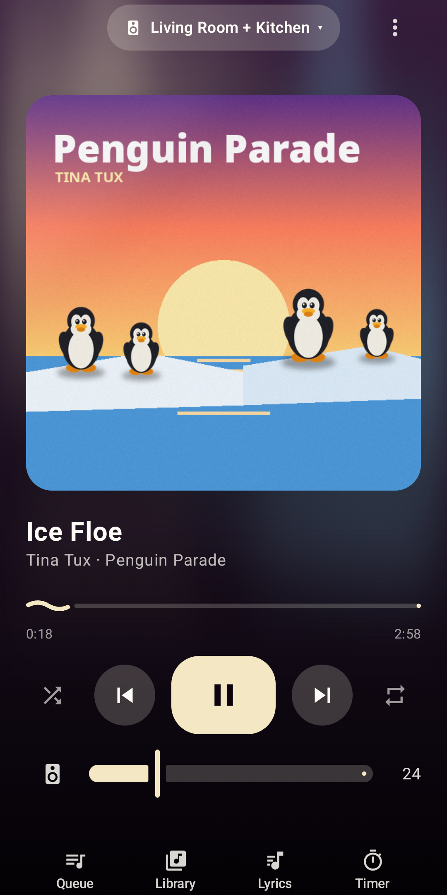
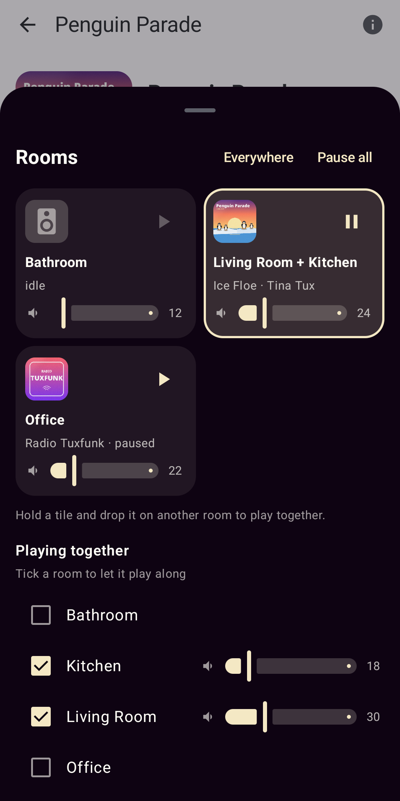
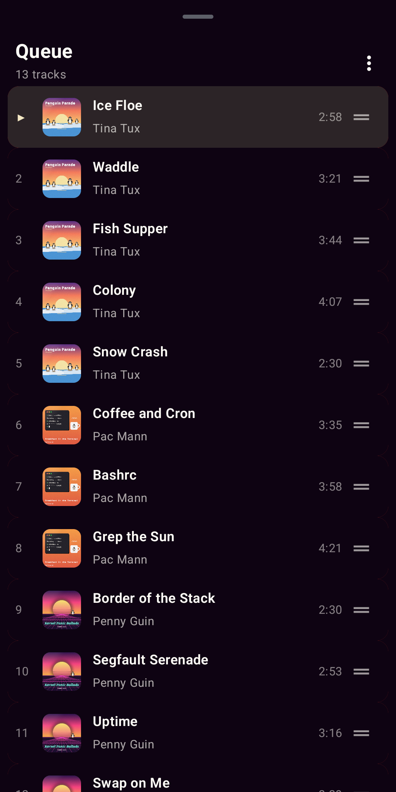
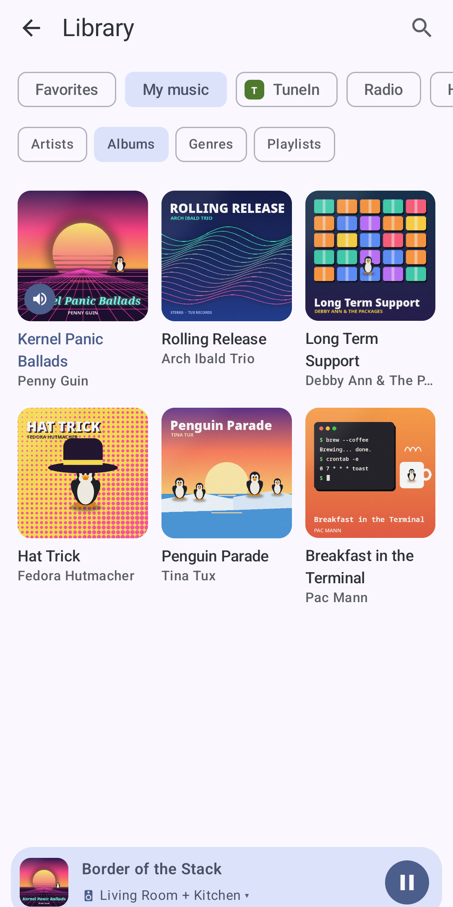
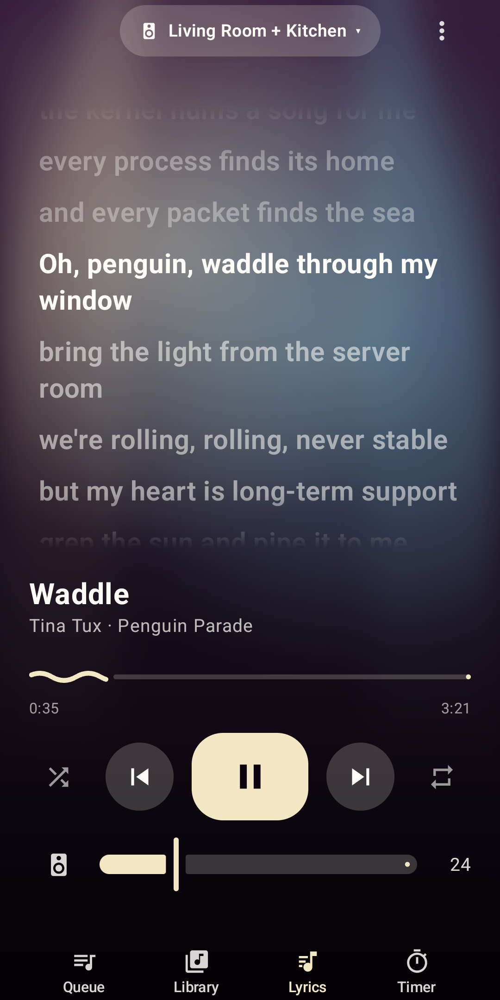

<p align="center">
  
</p>

<h1 align="center">Hausmusik</h1>

<p align="center"><strong>Music in every room. A fast, local Sonos controller for Android.</strong></p>

<p align="center">
  Hausmusik talks to your Sonos speakers directly over your home network.
  No Sonos account, no cloud, no tracking. It also keeps first-generation (S1) players going.
</p>

> [!NOTE]
> Hausmusik is in early development. Version 0.1.0 is the first public release; a Google Play release is being prepared.

<p align="center">
  
  
  
  
  
</p>

<p align="center"><sub>Screenshots from the built-in fake household: invented artists and covers.</sub></p>

## What it does

- **The Stage.** The app opens with what is playing, large and in the colors of the cover.
- **Every room at a glance.** Each group with its own volume and play button. Tick a room to let it play along.
- **Your library.** Sonos favorites, albums on your music share, radio stations and Sonos playlists.
- **Details.** Facts, a short Wikipedia text and a picture for the playing artist and album, from MusicBrainz, Wikipedia and the Cover Art Archive, all free sources. Also from the library (long press, or the info button on an album page) and the queue. Off until you switch them on.
- **Your Sonos, kept tidy.** Add albums, tracks and stations to the Sonos favorites or remove them, add anything to a Sonos playlist, rename and delete playlists, remove tracks from them: a long press in the library.
- **Line-in.** A speaker's analog input (a record player on a Connect:Amp) shows under Radio and plays in any room.
- **Everywhere.** One tap lets every room play along, except those you keep out in the settings. Crossfade is a switch in the stage menu.
- **Shortcuts, widgets, automation.** Long press the app icon for "pause everywhere" and favorites; a small widget plays or pauses one room or starts a favorite there; Tasker and Home Assistant can send the same commands as intents (see [docs/development.md](docs/development.md#commands-from-outside)).
- **Music video.** For many songs Wikidata knows the official YouTube video; Hausmusik opens it in the YouTube app at the point the speakers play (no ads with YouTube Premium). Otherwise a YouTube search. Off until you switch it on.
- **Lyrics.** Time-synced lyrics from LRCLIB fill the cover area; tap a line to jump there. When a live version runs off the stored times, press and hold the line being sung and the lyrics follow; the shift is remembered per track. Off until you switch them on.
- **Extras, each switchable.** Stage light in the cover's colors that dims to house lights in a pause; tap the cover four times in time and light and cover pulse along (the app cannot hear the music, so the beat is yours); a record turning beside the cover for albums; and the night stage, a screensaver while charging with cover, time and the line being sung. Android's "Remove animations" keeps everything still.
- **Alarms and sound.** Create and edit Sonos alarms, set bass, treble and loudness for every speaker, and a sleep timer that shows how long is left.
- **No surprises.** Before anything replaces a queue that is not empty, Hausmusik asks: play now, play next or add to the queue.
- **Part of Android.** Media notification and lock screen controls, a home screen widget and a Quick Settings tile. The volume buttons change the volume of your room, even outside the app.
- **Built for Android 17.** Jetpack Compose with Material 3 Expressive, English and German.

What is planned next is in [BACKLOG.md](BACKLOG.md).

## How it works

1. Hausmusik finds your speakers with an SSDP search in your Wi-Fi network, or you enter the address of one speaker.
2. It controls them with the same local UPnP interface the original Sonos apps used, on port 1400.
3. Nothing leaves your home network unless you ask for it: lyrics from LRCLIB, artist pictures from Deezer and artist and album details from MusicBrainz and Wikipedia and music videos through Wikidata are off until you switch them on, and a music service you link is asked for its catalogue.

The Sonos implementation is based on [noson](https://github.com/janbar/noson) by Jean-Luc Barrière, the library behind [noson-app](https://github.com/janbar/noson-app) and behind [Gnomos](https://github.com/linuxundich/gnomos), Hausmusik's sibling for the GNOME desktop.

Music services that link through a web page (AppLink or DeviceLink, such as [bonob](https://github.com/simojenki/bonob) and Spotify) can be linked under *Library → Services*: Hausmusik opens the service's sign-in page and receives its own token, the way noson does. Browsing and searching use that token; playing goes through the speakers with the account the Sonos system already has, so the service must be set up in the Sonos app first. Services with a user name and password form are not supported.

## Build

Requirements: JDK 21, Android SDK 37.

```sh
./gradlew :sonos:test :app:assembleDebug
```

For development without real speakers, `tools/fake-sonos/fake_sonos.py` provides an invented household. See [docs/development.md](docs/development.md).

Release notes for Google Play, store texts and the console forms are in
[docs/play-store.md](docs/play-store.md); the privacy policy is
[PRIVACY.md](PRIVACY.md).

## Credits

- [noson](https://github.com/janbar/noson) by Jean-Luc Barrière (GPL-3.0-or-later): the Sonos implementation is based on it; it was written anew in Kotlin, no noson source files are included.
- [SoCo](https://github.com/SoCo/SoCo) (MIT) as a second reference for protocol details.
- Jetpack libraries, Material Icons, OkHttp, Coil, Dagger/Hilt and Kotlin (Apache-2.0).
- Lyrics from [LRCLIB](https://lrclib.net), only when switched on.
- Artist and album facts from [MusicBrainz](https://musicbrainz.org) (CC0) and texts from [Wikipedia](https://www.wikipedia.org) (CC BY-SA), only when switched on.

The full list with licenses is in [NOTICE.md](NOTICE.md) and in the app under Settings, Open source licenses.

## Use of AI

Hausmusik is AI-assisted. Most of the code, the icon and the translations were written with AI assistance, directed by me: I set the requirements, made the design decisions, reviewed the results and test the app on my own Sonos household. Commits written with AI assistance carry a `Co-Authored-By` line.

Hausmusik is free software under the [GPL-3.0-or-later](LICENSE), © 2026 Christoph Langner. It is not affiliated with Sonos, Inc. Sonos is a trademark of Sonos, Inc.
